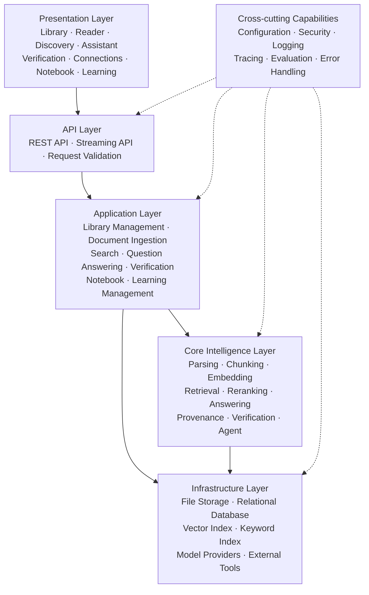

# AviAtlas — System Design Document

| Field | Description |
|---|---|
| Product | AviAtlas |
| Version | 0.1 |
| Status | Draft |
| Document Type | System Design Document |
| Last Updated | 2026-11-25 |
| Related Document | docs/product/requirements.md |

## 1. Introduction

### 1.1 Purpose

This document defines the high-level system architecture, component responsibilities, data flows, architectural principles, and technical direction of AviAtlas.

It serves as the foundation for subsequent detailed component designs, data modeling, API specifications, implementation, testing, and evaluation.

### 1.2 System Overview

AviAtlas is an AI-powered knowledge library and exploration platform that enables users to organize, access, understand, explore, connect, and verify knowledge across diverse disciplines.

The system supports traditional knowledge management capabilities while introducing interactive reading, intelligent retrieval, source-aware question answering, knowledge verification, and structured learning.

The initial system targets personal knowledge libraries, with a long-term architectural direction toward institutional and public library environments.

### 1.3 Document Scope

This document covers:

- High-level system architecture.
- Architectural principles.
- Logical system layers.
- Component responsibilities and boundaries.
- Core data entities.
- Document ingestion and indexing.
- Knowledge retrieval.
- Source-aware question answering.
- Knowledge verification.
- Storage architecture.
- API design principles.
- Reliability and observability.
- Testing and evaluation.
- Security and privacy.
- Scalability and future extensions.

Detailed implementation specifications will be maintained in separate design documents.

## 2. Architectural Goals

### 2.1 Modularity

The system should consist of components with clearly defined responsibilities, interfaces, and dependency boundaries.

Components should be independently testable and replaceable where practical.

### 2.2 Extensibility

The architecture should support the incremental introduction of new document formats, retrieval strategies, AI models, verification tools, and product capabilities.

### 2.3 Knowledge Traceability

Information retrieved or generated by the system should remain traceable to identifiable knowledge sources wherever possible.

The architecture must preserve relationships between original documents, structured content, retrieval chunks, supporting evidence, generated answers, and verification results.

### 2.4 Reliability

The system should support failure detection, recovery, consistent document lifecycle management, and reproducible processing.

Derived data should be rebuildable from authoritative knowledge resources.

### 2.5 Source-aware Intelligence

The system should support knowledge derived from library resources, AI model knowledge, external sources, user-provided information, and computational tools.

These sources must remain distinguishable throughout the answering and verification processes.

### 2.6 Observability

Important processing stages, retrieval decisions, model interactions, errors, and execution times should be observable.

### 2.7 Scalability

The architecture should support growing knowledge collections and provide a practical migration path toward larger institutional deployments.

### 2.8 Simplicity

Architectural complexity should be justified by actual product requirements.

The system should avoid premature service decomposition, unnecessary abstraction, and infrastructure that does not provide measurable benefits.

## 3. Architecture Style

### 3.1 Modular Monolith

AviAtlas will initially adopt a Modular Monolith architecture.

The backend will be implemented as a unified application containing logically separated components.

Each component will expose clearly defined interfaces and maintain explicit responsibilities.

The initial architecture does not require each component to be independently deployed.

### 3.2 Rationale

A Modular Monolith provides:

- Lower development and operational complexity.
- Easier local development and debugging.
- Simplified data consistency management.
- Reduced communication overhead.
- Clear component boundaries without distributed infrastructure.
- Incremental migration toward independently deployed services when necessary.

### 3.3 Future Service Decomposition

Components may be extracted into independent services when justified by workload, reliability, deployment, or scalability requirements.

Potential candidates include:

- Document processing workers.
- Embedding generation services.
- Retrieval services.
- AI inference services.
- Knowledge verification workers.
- Research execution services.

Service decomposition is not a requirement for the initial release.

## 4. High-Level System Architecture

The system is organized into five logical layers:

1. Presentation Layer.
2. API Layer.
3. Application Layer.
4. Core Intelligence Layer.
5. Infrastructure Layer.

Cross-cutting capabilities support the entire system.

### 4.1 Logical Architecture

The diagram represents logical collaboration