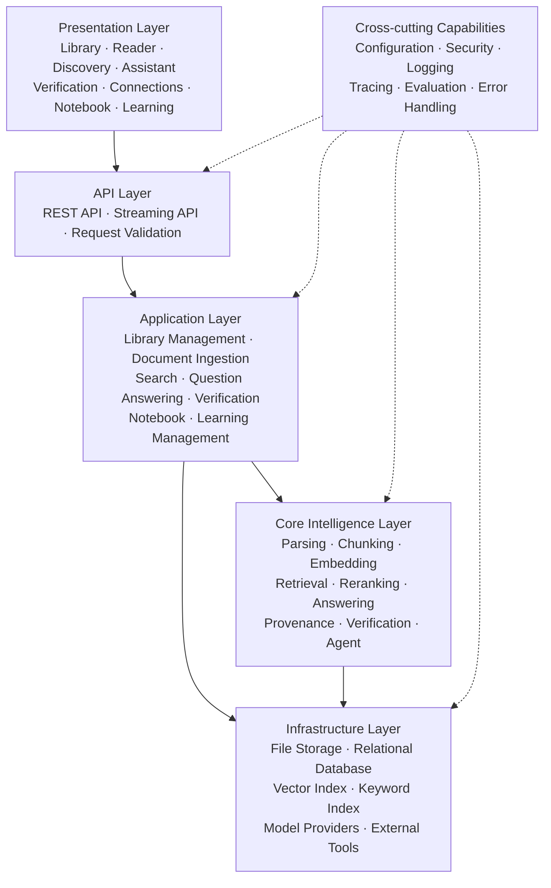
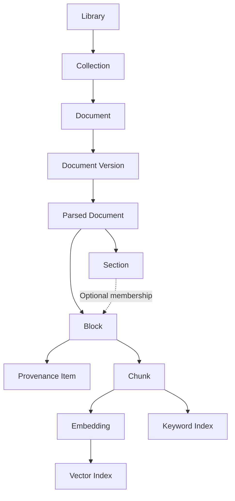
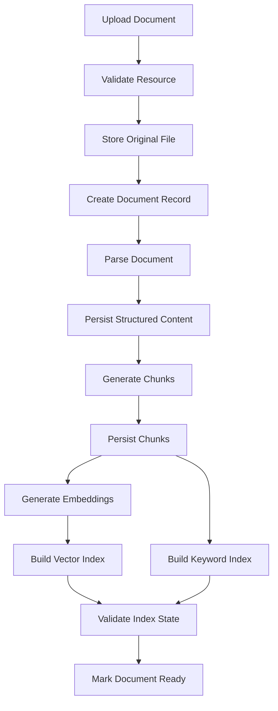
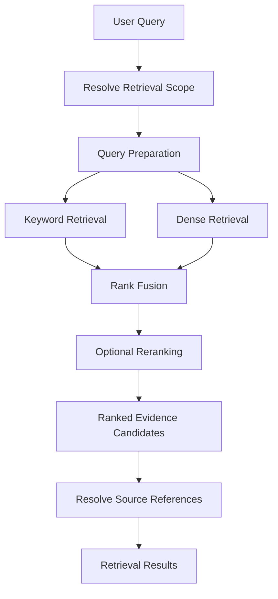
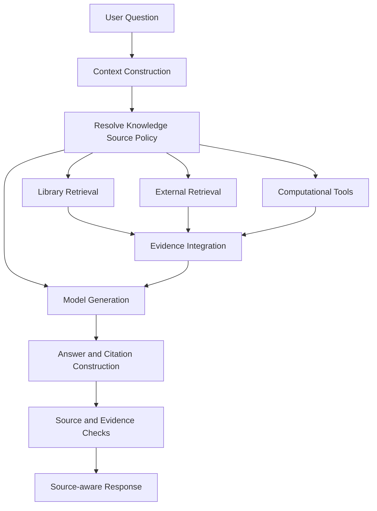
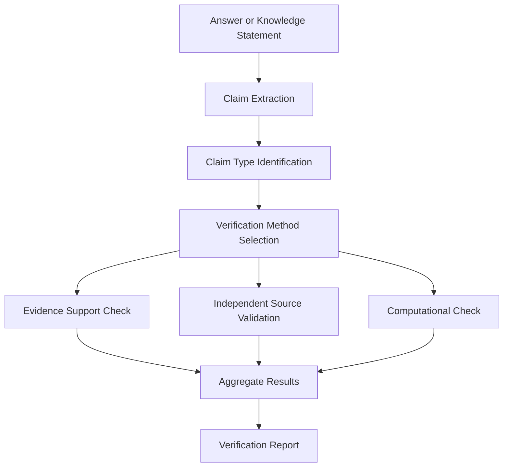
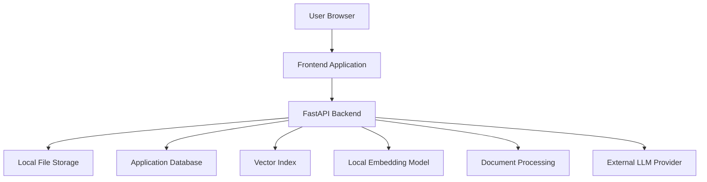

# AviAtlas — System Design Document

| Field            | Description                  |
| ---------------- | ---------------------------- |
| Product          | AviAtlas                     |
| Version          | 0.6                          |
| Status           | Draft                        |
| Document Type    | System Design Document       |
| Last Updated     | 2026-11-27                   |
| Related Document | docs/product/requirements.md |

## 1. Introduction

### 1.1 Purpose

This document defines the high-level system architecture, component responsibilities, data flows, architectural principles, and technical direction of AviAtlas.

It serves as the foundation for subsequent detailed component designs, data modeling, API specifications, implementation, testing, and evaluation.

### 1.2 System Overview

AviAtlas is an AI-powered knowledge library and exploration platform that enables users to organize, access, understand, explore, connect, and verify knowledge across diverse disciplines.

The system supports traditional knowledge management capabilities while introducing interactive reading, intelligent retrieval, source-aware question answering, knowledge verification, and structured learning.

The initial system targets personal knowledge libraries, with a long-term architectural direction toward institutional and public library environments.

### 1.3 Document Scope

This document covers:

- High-level system architecture.
- Architectural principles.
- Logical system layers.
- Component responsibilities and boundaries.
- Core data entities.
- Document ingestion and indexing.
- Knowledge retrieval.
- Source-aware question answering.
- Knowledge verification.
- Storage architecture.
- API design principles.
- Reliability and observability.
- Testing and evaluation.
- Security and privacy.
- Scalability and future extensions.

Detailed implementation specifications will be maintained in separate design documents.

## 2. Architectural Goals

### 2.1 Modularity

The system should consist of components with clearly defined responsibilities, interfaces, and dependency boundaries.

Components should be independently testable and replaceable where practical.

### 2.2 Extensibility

The architecture should support the incremental introduction of new document formats, retrieval strategies, AI models, verification tools, and product capabilities.

### 2.3 Knowledge Traceability

Information retrieved or generated by the system should remain traceable to identifiable knowledge sources wherever possible.

The architecture must preserve relationships between original documents, structured content, retrieval chunks, supporting evidence, generated answers, and verification results.

### 2.4 Reliability

The system should support failure detection, recovery, consistent document lifecycle management, and reproducible processing.

Derived data should be rebuildable from authoritative knowledge resources.

### 2.5 Source-aware Intelligence

The system should support knowledge derived from library resources, AI model knowledge, external sources, user-provided information, and computational tools.

These sources must remain distinguishable throughout the answering and verification processes.

### 2.6 Observability

Important processing stages, retrieval decisions, model interactions, errors, and execution times should be observable.

### 2.7 Scalability

The architecture should support growing knowledge collections and provide a practical migration path toward larger institutional deployments.

### 2.8 Simplicity

Architectural complexity should be justified by actual product requirements.

The system should avoid premature service decomposition, unnecessary abstraction, and infrastructure that does not provide measurable benefits.

## 3. Architecture Style

### 3.1 Modular Monolith

AviAtlas will initially adopt a Modular Monolith architecture.

The backend will be implemented as a unified application containing logically separated components.

Each component will expose clearly defined interfaces and maintain explicit responsibilities.

The initial architecture does not require each component to be independently deployed.

### 3.2 Rationale

A Modular Monolith provides:

- Lower development and operational complexity.
- Easier local development and debugging.
- Simplified data consistency management.
- Reduced communication overhead.
- Clear component boundaries without distributed infrastructure.
- Incremental migration toward independently deployed services when necessary.

### 3.3 Future Service Decomposition

Components may be extracted into independent services when justified by workload, reliability, deployment, or scalability requirements.

Potential candidates include:

- Document processing workers.
- Embedding generation services.
- Retrieval services.
- AI inference services.
- Knowledge verification workers.
- Research execution services.

Service decomposition is not a requirement for the initial release.

## 4. High-Level System Architecture

The system is organized into five logical layers:

1. Presentation Layer.
2. API Layer.
3. Application Layer.
4. Core Intelligence Layer.
5. Infrastructure Layer.

Cross-cutting capabilities support the entire system.

### 4.1 Logical Architecture



The diagram represents logical collaboration between system layers rather than mandatory source-code dependency directions.

Infrastructure implementations should be accessed through appropriate interfaces where isolation provides practical benefits.

### 4.2 Presentation Layer

The Presentation Layer provides user-facing functionality.

It includes:

- Knowledge Library.
- Interactive Reader.
- Knowledge Discovery.
- Knowledge Assistant.
- Knowledge Verification.
- Knowledge Connections.
- Knowledge Notebook.
- Learning Workspace.

Responsibilities:

- Present knowledge resources and application state.
- Capture user interactions.
- Provide document reading and navigation.
- Display search results and generated answers.
- Display citations, supporting evidence, and verification results.
- Manage client-side interaction state.

The Presentation Layer must not directly access backend databases, vector indexes, or model provider credentials.

### 4.3 API Layer

The API Layer exposes system functionality to external clients.

Responsibilities:

- Request and response validation.
- Request routing.
- Authentication and authorization integration.
- API serialization.
- Error response mapping.
- Streaming response delivery.
- Request-level tracing.

API endpoints should delegate business operations to application components.

Complex document processing, retrieval, and answering logic should not be implemented directly inside endpoint handlers.

### 4.4 Application Layer

The Application Layer coordinates business operations and workflows.

Primary responsibilities include:

- Library management.
- Document lifecycle management.
- Document ingestion.
- Reading context management.
- Knowledge search.
- Question answering.
- Knowledge verification workflows.
- Conversation management.
- Notebook management.
- Learning management.

Application components coordinate core intelligence capabilities and infrastructure resources.

They are responsible for managing workflow state, operation boundaries, and business-level error handling.

### 4.5 Core Intelligence Layer

The Core Intelligence Layer contains reusable knowledge processing and AI capabilities.

Primary components include:

- Parsing.
- Chunking.
- Embedding.
- Retrieval.
- Reranking.
- Answering.
- Agent orchestration.
- Provenance.
- Verification.
- Concept extraction.
- Context and memory processing.
- Learning intelligence.

These components should be independently testable wherever practical.

They should not depend directly on HTTP request objects or frontend-specific representations.

### 4.6 Infrastructure Layer

The Infrastructure Layer provides concrete integrations with storage systems, model providers, and external tools.

Primary capabilities include:

- Original file storage.
- Relational data storage.
- Vector indexes.
- Keyword indexes.
- Model provider integrations.
- Embedding model integrations.
- External information retrieval.
- Computational tools.
- Background task execution.

Infrastructure components implement the persistence and integration mechanisms required by application and core components.

### 4.7 Cross-cutting Capabilities

Cross-cutting capabilities include:

- Configuration management.
- Security and access control.
- Structured logging.
- Distributed or local tracing.
- Performance monitoring.
- Error handling.
- Evaluation.
- Testing.

These capabilities should be integrated consistently without unnecessarily coupling unrelated components.

## 5. Component Design

### 5.1 Library Management

**Responsibilities**

- Manage knowledge resources.
- Manage collections and resource membership.
- Maintain document metadata.
- Coordinate resource creation, updates, and deletion.
- Expose document processing status.

**Boundaries**

Library Management does not implement document parsing, embedding generation, or retrieval algorithms.

### 5.2 Document Ingestion

**Responsibilities**

- Coordinate document ingestion workflows.
- Validate uploaded resources.
- Store original files.
- Invoke document parsing.
- Persist structured document content.
- Coordinate chunking, embedding, and indexing.
- Maintain processing state.
- Handle retries and processing failures.

**Boundaries**

Document Ingestion coordinates processing components but does not implement their underlying algorithms.

### 5.3 Parsing

**Responsibilities**

- Convert source documents into structured representations.
- Extract document metadata where available.
- Identify headings, paragraphs, tables, figures, equations, and other content blocks.
- Preserve reading order.
- Preserve page and region-level provenance.
- Support OCR for applicable document formats.

**Conceptual Interface**

```text
Source Document → Parsed Document
```

**Boundaries**

Parsing does not generate retrieval chunks, embeddings, or answers.

The parser should not be responsible for application-level document lifecycle management.

### 5.4 Chunking

**Responsibilities**

- Convert structured document content into retrieval-oriented chunks.
- Preserve meaningful content boundaries.
- Retain references to original content blocks.
- Maintain section and document context.
- Preserve provenance information.
- Support configurable chunking strategies.

**Conceptual Interface**

```text
Parsed Document + Chunking Configuration
    → Retrieval Chunks
```

**Boundaries**

Chunking does not generate embeddings or modify original document content.

### 5.5 Embedding

**Responsibilities**

- Convert supported content into vector representations.
- Generate query embeddings.
- Support batch embedding.
- Track embedding model identity and relevant configuration.

**Conceptual Interface**

```text
Text or Supported Content → Vector Representation
```

**Boundaries**

Embedding does not determine document lifecycle, search ranking, or answer generation.

### 5.6 Indexing

**Responsibilities**

- Build searchable representations of knowledge resources.
- Maintain vector indexes.
- Maintain keyword indexes.
- Synchronize indexes with authoritative document records.
- Remove obsolete index entries.
- Support index rebuilding.

**Boundaries**

Indexes are derived data and must not become the sole authoritative representation of documents or knowledge resources.

### 5.7 Retrieval

**Responsibilities**

- Retrieve relevant knowledge chunks.
- Support keyword-based retrieval.
- Support dense vector retrieval.
- Support hybrid retrieval.
- Apply document and collection filters.
- Combine results from multiple retrieval strategies.
- Preserve retrieval scores and ranking information.
- Return identifiable source references.

**Conceptual Interface**

```text
Query + Retrieval Scope + Retrieval Configuration
    → Ranked Retrieval Results
```

**Boundaries**

Retrieval returns relevant information candidates.

It does not establish the factual correctness of retrieved content or generate final answers.

### 5.8 Reranking

**Responsibilities**

- Refine the ordering of retrieved candidates.
- Estimate query-content relevance.
- Preserve original retrieval scores and ranking information.
- Support evaluation of ranking improvements.

Reranking may initially be implemented within the Retrieval component.

A separate deployment service is not required.

### 5.9 Answering

**Responsibilities**

- Construct model input from user questions and relevant context.
- Integrate retrieved evidence.
- Apply knowledge source policies.
- Generate natural-language responses.
- Associate evidence-grounded statements with citations.
- Distinguish unsupported model-generated explanations.
- Communicate uncertainty and insufficient evidence.

**Conceptual Interface**

```text
Question + Context + Evidence + Source Policy
    → Source-aware Answer
```

**Boundaries**

Answering must not fabricate citations or present unsupported explanations as verified facts.

Answer generation and independent verification remain distinct responsibilities.

### 5.10 Agent Orchestration

**Responsibilities**

- Coordinate multi-step knowledge exploration.
- Decompose complex questions.
- Select permitted tools.
- Perform iterative retrieval.
- Coordinate external search and computation.
- Manage execution state and termination conditions.

Agent workflows should enforce appropriate limits on execution time, tool calls, and model usage.

Agent orchestration is an advanced capability and is not required for the initial question answering pipeline.

### 5.11 Provenance

**Responsibilities**

- Maintain references to original knowledge resources.
- Map structured content to source document locations.
- Map retrieval chunks to original content blocks.
- Associate answer citations with supporting evidence.
- Resolve citations to document pages and regions.
- Preserve source information across notes and verification records.

Provenance is a shared capability across document processing, retrieval, answering, verification, and reading.

It should be preserved throughout the system rather than reconstructed only after answer generation.

### 5.12 Verification

**Responsibilities**

- Identify important knowledge claims.
- Examine supporting evidence.
- Detect unsupported claims.
- Detect conflicting evidence.
- Coordinate independent source validation.
- Coordinate applicable computational checks.
- Produce inspectable verification results.

**Conceptual Interface**

```text
Knowledge Claims + Available Evidence + Verification Policy
    → Verification Report
```

**Boundaries**

Verification does not guarantee absolute correctness.

A successful check establishes only what the specific verification method, evidence, and assumptions support.

### 5.13 Context and Memory

**Responsibilities**

- Maintain conversation context.
- Manage reading context.
- Retrieve relevant historical interactions.
- Construct bounded context for model execution.
- Support persistent user knowledge where appropriate.

The system should distinguish:

- Short-term conversation context.
- Current reading context.
- Persistent user notes.
- Long-term learning records.

Persistent memory must respect user privacy and deletion requirements.

### 5.14 Concept Extraction and Knowledge Connections

**Responsibilities**

- Identify meaningful concepts.
- Discover relationships between concepts and documents.
- Identify potential prerequisite relationships.
- Support cross-disciplinary exploration.
- Preserve evidence for proposed relationships.
- Support future knowledge graph construction.

A dedicated graph database is not required until persistent graph operations justify its introduction.

### 5.15 Notebook Management

**Responsibilities**

- Manage notes, highlights, and annotations.
- Save selected AI-generated explanations.
- Preserve source and verification references.
- Support note organization and retrieval.

Notes should remain distinguishable from published resources and verified knowledge.

### 5.16 Learning Management

**Responsibilities**

- Manage learning goals.
- Coordinate learning path generation.
- Associate learning topics with knowledge resources.
- Track learning progress.
- Support practice and assessment workflows.

Learning Management reuses retrieval, answering, knowledge connections, and notebook capabilities.

## 6. Component Dependency Principles

The following dependency rules guide implementation:

- Presentation components communicate with backend functionality through defined APIs.
- API handlers delegate business operations to application components.
- Application components coordinate core capabilities and infrastructure integrations.
- Core processing components should not depend on frontend or HTTP-specific objects.
- Storage and model integrations should not contain unrelated business logic.
- Shared data contracts should be explicitly defined.
- Circular dependencies between components should be avoided.
- Abstractions should be introduced when they provide meaningful isolation, testability, or replaceability.

Product modules do not necessarily correspond to individual backend packages or deployment services.

Multiple product modules may reuse the same core intelligence capabilities.

## 7. Conceptual Data Model

### 7.1 Core Entities

| Entity             | Responsibility                                                        |
| ------------------ | --------------------------------------------------------------------- |
| Library            | Represents a personal or institutional knowledge collection boundary. |
| Collection         | Organizes related knowledge resources.                                |
| Document           | Represents a managed knowledge resource.                              |
| DocumentVersion    | Represents a particular version of a document.                        |
| ParsedDocument     | Represents the structured result of document parsing.                 |
| Section            | Represents a logical document subdivision.                            |
| Block              | Represents an individual structured content unit.                     |
| ProvenanceItem     | Identifies the original source location of content.                   |
| Chunk              | Represents a retrieval-oriented content unit.                         |
| Embedding          | Represents a vector representation associated with content.           |
| Conversation       | Represents an ongoing user interaction.                               |
| Message            | Represents an individual conversation entry.                          |
| Answer             | Represents a generated response.                                      |
| Claim              | Represents an identifiable knowledge statement.                       |
| Evidence           | Represents information relevant to a knowledge claim.                 |
| Citation           | Connects generated content to supporting evidence.                    |
| VerificationResult | Represents the outcome of a verification procedure.                   |
| Note               | Represents user-created or saved knowledge.                           |
| Annotation         | Represents a user annotation associated with source content.          |
| Concept            | Represents an identifiable knowledge concept.                         |
| ConceptRelation    | Represents a proposed relationship between concepts.                  |
| LearningGoal       | Represents a user-defined learning objective.                         |
| LearningPath       | Represents a structured sequence of learning activities.              |

These entities represent conceptual responsibilities rather than finalized database tables.

Some entities may initially be represented as nested data structures rather than independently persisted records.

### 7.2 Document Knowledge Structure



A document may belong to multiple collections.

A chunk may reference multiple blocks, and a block may contribute to multiple chunks.

Document structure and retrieval structure must remain logically distinct.

### 7.3 Authoritative and Derived Data

**Authoritative data includes:**

- Original document files.
- Document identity and metadata.
- Collection membership.
- User-created notes.
- User annotations.
- Conversation records.
- Recorded verification results.

**Derived data includes:**

- Parsed document representations.
- Retrieval chunks.
- Embeddings.
- Vector indexes.
- Keyword indexes.
- Automatically extracted concepts.
- Automatically inferred concept relationships.

Derived data should retain the processing configuration and source version required for reproducibility where practical.

User corrections to derived data, such as edited chunk text or chunks excluded from retrieval, are authoritative data. They must be stored separately from the generated chunks, with references to their source blocks, and reapplied when chunks and indexes are rebuilt. Rebuilding must never silently discard a user correction; a correction whose source blocks no longer exist must be surfaced for review.

### 7.4 Document Versioning

The architecture should accommodate document versioning and reprocessing.

Existing citations and annotations should not silently point to unrelated content after a document is updated.

Detailed versioning and citation migration policies will be defined in the Data Model Design.

## 8. Document Ingestion Pipeline

### 8.1 Overview

The Document Ingestion Pipeline transforms original knowledge resources into structured and searchable representations.

### 8.2 Processing Flow



### 8.3 Processing Stages

1. Validate file type, size, and basic integrity.
2. Store the original resource.
3. Create or update the document record.
4. Parse the document.
5. Persist structured content and provenance.
6. Generate retrieval chunks.
7. Persist chunk metadata and source relationships.
8. Generate embeddings.
9. Build the configured search indexes.
10. Validate processing results.
11. Mark the document as available for retrieval.

The initial release may use only a vector index. Keyword indexing will be introduced with hybrid retrieval.

### 8.4 Document Processing State

Proposed processing states:

| State        | Description                                             |
| ------------ | ------------------------------------------------------- |
| Uploaded     | The original resource has been received.                |
| Pending      | The document is waiting for processing.                 |
| Processing   | One or more processing stages are active.               |
| Ready        | Required processing and indexing stages have completed. |
| Failed       | Processing failed and requires recovery or retry.       |
| Reprocessing | A new processing operation is rebuilding derived data.  |
| Deleting     | The document and associated data are being removed.     |

Detailed stage-level progress should be tracked separately from the overall document state.

### 8.5 Failure Recovery

The ingestion pipeline should:

- Record the failed processing stage.
- Preserve useful diagnostic information.
- Support safe retries.
- Avoid creating duplicate index entries.
- Prevent incomplete index data from being exposed as ready content.
- Preserve original files when derived processing fails.

Long-running document processing should eventually execute outside the synchronous HTTP request lifecycle.

## 9. Knowledge Retrieval Pipeline

### 9.1 Overview

The Retrieval Pipeline identifies relevant knowledge resources for search, answering, verification, and other product capabilities.

### 9.2 Retrieval Flow



### 9.3 Retrieval Scope

Retrieval may be restricted by:

- Selected document.
- Selected collection.
- Entire accessible library.
- Document metadata.
- Document type.
- Applicable access permissions.

Access restrictions must be applied consistently across retrieval strategies.

### 9.4 Keyword Retrieval

Keyword retrieval supports exact terminology, identifiers, technical expressions, names, and lexical relevance.

BM25 is the proposed initial keyword ranking method.

### 9.5 Dense Retrieval

Dense retrieval uses embedding representations to identify semantically relevant content.

The embedding model and similarity configuration must be identifiable for reproducible evaluation.

### 9.6 Hybrid Retrieval

Hybrid retrieval combines keyword and dense retrieval results.

Reciprocal Rank Fusion is the proposed initial fusion strategy.

The final selection of retrieval parameters should be based on evaluation rather than assumed superiority.

### 9.7 Retrieval Result Structure

A retrieval result should preserve:

- Chunk identity.
- Document identity.
- Relevant content.
- Source location.
- Retrieval method.
- Original retrieval rank.
- Original retrieval score.
- Fusion score where applicable.
- Reranking score where applicable.

Scores from different retrieval methods must not be treated as directly comparable without an appropriate normalization or fusion strategy.

### 9.8 Retrieval Diagnostics

The system should support inspection of:

- Original query.
- Prepared query.
- Retrieval scope.
- Keyword candidates.
- Dense retrieval candidates.
- Fusion results.
- Reranking results.
- Final selected evidence.
- Stage-level execution time.

Retrieval diagnostics should support both interactive debugging and reproducible offline evaluation.

## 10. Knowledge Answering Pipeline

### 10.1 Overview

The Knowledge Answering Pipeline generates contextual and source-aware responses using permitted knowledge sources.

### 10.2 Answering Flow



External retrieval and computational tools are optional and depend on the selected answering mode and available capabilities.

Model knowledge is used through model generation rather than retrieved as an independently identifiable document source.

### 10.3 Context Construction

Relevant context may include:

- User question.
- Current document.
- Current page or section.
- Selected text.
- Surrounding document content.
- Conversation history.
- Retrieval scope.
- User-selected answering mode.

Context construction should respect model input limits and avoid unnecessary disclosure of private information.

### 10.4 Knowledge Source Policy

The system should support explicit policies governing permitted knowledge sources.

| Policy            | Permitted Knowledge Sources                                                           |
| ----------------- | ------------------------------------------------------------------------------------- |
| Document-grounded | Selected document evidence                                                            |
| Library-grounded  | Accessible library evidence                                                           |
| Open Knowledge    | Library evidence and model-generated explanations                                     |
| Research          | Library evidence, model-generated explanations, external sources, and permitted tools |

Document-grounded and library-grounded modes should report insufficient evidence when the available material cannot support an answer.

Open Knowledge mode should distinguish supplementary model-generated explanations from source-grounded information.

### 10.5 Evidence Integration

Evidence integration should:

- Remove unnecessary duplicate content.
- Preserve evidence identifiers.
- Maintain relevant source information.
- Respect context size constraints.
- Preserve material source conflicts.
- Avoid introducing inaccessible resources.

### 10.6 Answer Representation

A source-aware answer may contain:

- Generated answer text.
- Important knowledge claims.
- Source type annotations.
- Supporting evidence references.
- Citations.
- Verification status.
- Uncertainty information.
- Model execution metadata.

The initial implementation may use section-level source annotations before introducing more detailed claim-level representations.

### 10.7 Citation Construction

Citations must refer to identifiable evidence.

The system should validate that citation identifiers correspond to available source records.

Citation existence and citation support are separate checks.

A valid source identifier does not establish that the cited content supports the associated claim.

## 11. Knowledge Verification Pipeline

### 11.1 Overview

The Verification Pipeline evaluates important knowledge claims using available evidence and applicable verification methods.

Verification may occur automatically for selected checks or be explicitly requested by the user.

### 11.2 Verification Flow



Only applicable and permitted verification methods should be executed.

### 11.3 Verification Methods

Potential verification methods include:

- Citation existence validation.
- Citation support checking.
- Independent evidence retrieval.
- Evidence contradiction detection.
- Symbolic computation.
- Numerical computation.
- Dimensional analysis.
- Code execution and testing.
- Formal proof checking.

Advanced verification methods will be introduced incrementally.

### 11.4 Verification Result Structure

A verification result should preserve:

- Claim identifier.
- Verification method.
- Supporting evidence.
- Contradictory evidence where available.
- Relevant assumptions.
- Verification outcome.
- Execution metadata.
- Limitations.

### 11.5 Verification Principles

- Source origin and verification status must remain distinct.
- Multiple models agreeing on an answer does not establish correctness.
- Evidence independence must be considered during cross-validation.
- Computational verification must preserve its assumptions and scope.
- Unsupported claims should remain explicitly identifiable.
- Conflicting evidence must not be silently discarded.
- Verification failures must not be represented as successful validation.

## 12. Storage Architecture

### 12.1 Storage Responsibilities

The system should separate original resources, authoritative application records, structured content, and derived search indexes.

| Storage Category           | Stored Information                                                                             |
| -------------------------- | ---------------------------------------------------------------------------------------------- |
| File Storage               | Original documents and extracted binary assets                                                 |
| Relational Storage         | Document metadata, collections, lifecycle state, conversations, notes, and application records |
| Structured Content Storage | Parsed content, sections, blocks, chunks, and provenance                                       |
| Vector Index               | Embeddings and associated retrieval identifiers                                                |
| Keyword Index              | Searchable lexical representations                                                             |
| Graph Storage              | Optional persistent concepts and relationships                                                 |
| Execution Records          | Processing logs, evaluation results, and verification records                                  |

These categories represent logical storage responsibilities.

Multiple categories may share the same physical storage system in the initial release.

### 12.2 Storage Principles

- Original documents must remain independent of search indexes.
- Application records must have stable identities.
- Derived indexes must be rebuildable.
- Index entries must retain references to authoritative records.
- Deletion and update operations must account for associated derived data.
- Processing configuration and model versions should be recorded where required for reproducibility.

### 12.3 Data Consistency

Document processing may involve multiple storage systems that do not share a single transaction boundary.

The system should therefore use explicit lifecycle states, retryable operations, and reconciliation procedures to maintain consistency.

The initial architecture does not require distributed transactions.

### 12.4 Index Rebuilding

The system should support rebuilding indexes when:

- Embedding models change.
- Chunking strategies change.
- Retrieval configurations change.
- Document versions change.
- Index corruption or inconsistency is detected.

Existing usable indexes should be preserved during rebuilding where practical.

## 13. API Architecture

### 13.1 API Principles

The API should:

- Expose clearly defined application operations.
- Use consistent request and response structures.
- Validate input data.
- Provide meaningful error responses.
- Support pagination for large result sets.
- Support streaming for applicable AI operations.
- Expose processing status for long-running operations.

### 13.2 Proposed API Groups

| API Group     | Responsibility                                            |
| ------------- | --------------------------------------------------------- |
| Documents     | Upload, retrieve, update, delete, and reprocess documents |
| Collections   | Manage collections and document membership                |
| Reader        | Retrieve document content and reading context             |
| Search        | Execute knowledge retrieval                               |
| Conversations | Manage conversations and messages                         |
| Answers       | Generate source-aware responses                           |
| Citations     | Resolve citations to original source locations            |
| Verification  | Request and inspect verification operations               |
| Notes         | Manage notes and annotations                              |
| Connections   | Explore concepts and relationships                        |
| Learning      | Manage learning goals and learning paths                  |
| Diagnostics   | Inspect processing and retrieval execution                |

### 13.3 Illustrative Endpoints

```text
POST   /api/v1/documents
GET    /api/v1/documents
GET    /api/v1/documents/{document_id}
DELETE /api/v1/documents/{document_id}

GET    /api/v1/documents/{document_id}/status
POST   /api/v1/documents/{document_id}/reprocess

POST   /api/v1/collections
GET    /api/v1/collections

POST   /api/v1/search
POST   /api/v1/search/debug

POST   /api/v1/conversations
POST   /api/v1/conversations/{conversation_id}/messages

GET    /api/v1/citations/{citation_id}

POST   /api/v1/verifications
GET    /api/v1/verifications/{verification_id}

POST   /api/v1/notes
GET    /api/v1/notes
```

These endpoints are illustrative and do not constitute finalized API contracts.

### 13.4 Streaming

Server-Sent Events are a candidate mechanism for delivering incremental AI responses.

Potential event types include:

- Response started.
- Retrieval completed.
- Answer delta.
- Citation available.
- Verification status.
- Response completed.
- Error.

Streaming events should not expose private model reasoning or sensitive internal information.

## 14. Technology Direction

The following technologies represent the current implementation direction and candidate selections.

Final decisions should be documented through component designs and Architecture Decision Records.

| Component                  | Proposed Technology                       | Status                |
| -------------------------- | ----------------------------------------- | --------------------- |
| Backend Language           | Python                                    | Established direction |
| Backend Framework          | FastAPI                                   | Established direction |
| Data Validation            | Pydantic                                  | Established direction |
| Document Parsing           | Docling (PDF, DOCX); own Markdown/TXT parser | Initial selection  |
| OCR                        | RapidOCR via Docling, routed by PDF text layer | Initial selection |
| Embedding                  | Sentence Transformers                     | Initial selection     |
| Embedding Model            | paraphrase-multilingual-MiniLM-L12-v2 (BGE family candidate) | Initial selection |
| Vector Index               | ChromaDB (backend-neutral interface; Milvus planned, see ADR 0001) | Initial selection |
| Relational Database        | SQLite (PostgreSQL for Phase 5)           | Initial selection     |
| Keyword Retrieval          | Application-layer BM25, jieba tokenization, SQLite postings (ADR 0003) | Initial selection |
| Rank Fusion                | Reciprocal Rank Fusion (k = 60, pending evaluation, ADR 0003) | Initial selection |
| Reranking                  | Cross-encoder models                      | Candidate             |
| LLM Integration            | OpenRouter                                | Initial selection     |
| Agent Orchestration        | LangGraph (conversation and agent orchestration only, see ADR 0002) | Initial selection (conversation turns) |
| Computational Verification | SymPy and controlled execution tools      | Candidate             |
| Formal Verification        | Lean                                      | Future exploration    |
| Frontend                   | React + Vite                              | Established direction |
| Document Reader            | react-pdf (PDF.js)                        | Established direction |
| Streaming                  | Server-Sent Events                        | Initial selection     |
| Testing                    | pytest                                    | Established direction |
| Graph Storage              | Neo4j or alternative graph representation | Deferred              |
| Background Execution       | Local worker or task queue                | Pending               |

Technology selections should remain aligned with actual product requirements, implementation complexity, operating costs, and measured performance.

## 15. Reliability and Error Handling

### 15.1 Error Categories

The system should distinguish:

- Input validation errors.
- Resource not found errors.
- Unsupported document errors.
- Document processing errors.
- Storage errors.
- Indexing errors.
- Retrieval errors.
- Model provider errors.
- Verification errors.
- Authorization errors.
- Internal system errors.

### 15.2 Retry Policy

Retries should be applied selectively to transient failures.

Examples include:

- Temporary network failures.
- Model provider rate limits.
- Temporary external service failures.
- Retryable background processing failures.

Invalid input and permanent processing failures should not be retried indefinitely.

### 15.3 Idempotency

Operations that may be retried should avoid unintended duplicate side effects.

Relevant operations include:

- Document ingestion.
- Chunk persistence.
- Index construction.
- Reprocessing.
- Document deletion.
- Background task execution.

### 15.4 Graceful Degradation

The system should preserve available functionality when optional components fail.

Examples:

- Search remains available when the LLM provider is unavailable.
- Document reading remains available when retrieval is unavailable.
- Answers may remain available when optional verification tools fail, with explicit verification limitations.
- Hybrid retrieval may fall back to an available retrieval method when permitted by configuration.

Fallback behavior should be observable and must not silently misrepresent the result.

## 16. Observability

### 16.1 Structured Logging

Important operations should produce structured logs containing relevant information such as:

- Operation identifier.
- Request identifier.
- Document identifier.
- Processing stage.
- Execution duration.
- Component identity.
- Operation status.
- Error category.

Sensitive content and credentials must not be unnecessarily included in logs.

### 16.2 Execution Tracing

The system should support tracing across:

- API requests.
- Document ingestion.
- Parsing.
- Chunking.
- Embedding.
- Indexing.
- Retrieval.
- Answer generation.
- Verification.

### 16.3 Retrieval Inspector

The Retrieval Inspector should expose relevant retrieval execution details, including:

- Retrieval scope.
- Keyword retrieval candidates.
- Dense retrieval candidates.
- Original rankings and scores.
- Fusion results.
- Reranking results.
- Selected evidence.
- Source locations.
- Stage-level execution time.

The inspector should help developers identify whether a failure originated in parsing, chunking, indexing, retrieval, context construction, or answer generation.

### 16.4 Operational Metrics

Potential operational metrics include:

- Document processing success rate.
- Processing latency.
- Retrieval latency.
- Model response latency.
- Verification latency.
- Model token usage.
- External service failure rate.
- Background task failure rate.
- Index consistency errors.

## 17. Testing and Evaluation

### 17.1 Unit Testing

Unit tests should cover individual component behavior and data contracts.

Examples include:

- Parsing data validation.
- Bounding box validation.
- Chunk boundary handling.
- Source reference preservation.
- Rank fusion.
- Citation identifier validation.
- Verification result validation.

### 17.2 Integration Testing

Integration tests should verify interactions between components.

Examples include:

- Parsing and chunking.
- Chunk persistence and indexing.
- Retrieval and provenance resolution.
- Answer generation and citation construction.
- Document deletion and index cleanup.
- Failure recovery and reprocessing.

### 17.3 End-to-End Testing

End-to-end tests should validate complete user workflows.

The primary initial workflow is:

```text
Upload PDF
    → Process Document
    → Read Document
    → Search Knowledge
    → Ask Contextual Question
    → Receive Source-aware Answer
    → Navigate to Original Evidence
```

### 17.4 Retrieval Evaluation

Retrieval evaluation should use fixed question sets with annotated relevant evidence.

Potential metrics include:

- Recall@K.
- Precision@K.
- Hit Rate@K.
- Mean Reciprocal Rank.
- nDCG@K.
- Retrieval latency.

Evaluation should compare applicable retrieval configurations:

- Keyword retrieval.
- Dense retrieval.
- Hybrid retrieval.
- Hybrid retrieval with reranking.

### 17.5 Answer Evaluation

Answer evaluation should measure:

- Correctness.
- Relevance.
- Evidence-groundedness.
- Unsupported claim rate.
- Appropriate handling of insufficient evidence.
- Source classification accuracy.

### 17.6 Provenance Evaluation

Provenance evaluation should measure:

- Citation validity.
- Citation support accuracy.
- Citation completeness.
- Document identification accuracy.
- Page localization accuracy.
- Region localization accuracy.

### 17.7 Verification Evaluation

Verification evaluation should measure:

- Correct identification of supported claims.
- Correct identification of unsupported claims.
- Conflict detection.
- Verification coverage.
- False verification rate.
- Verification execution cost.

### 17.8 Reproducibility

Evaluation records should preserve:

- Dataset version.
- Document versions.
- Parser configuration.
- Chunking configuration.
- Embedding model version.
- Retrieval configuration.
- Model identity.
- Relevant prompts.
- Evaluation methodology.

Quantitative acceptance thresholds will be defined after baseline measurements.

## 18. Security and Privacy

### 18.1 Resource Access

Personal knowledge resources should remain private by default.

Future institutional deployments must enforce access restrictions across:

- Document retrieval.
- Search indexes.
- Generated answers.
- Citations.
- External tool interactions.
- Shared collections.

### 18.2 External Model Providers

The system should minimize the information transmitted to external AI providers.

Users should be informed when private document content may be processed by external services.

Provider credentials must not be exposed to frontend clients or committed to source control.

### 18.3 Untrusted Knowledge Resources

Uploaded documents and externally retrieved content must be treated as untrusted input.

Document content must not be allowed to override system policies, authorize tool execution, or bypass access restrictions.

The system should account for indirect prompt injection and malicious document content.

### 18.4 Tool Execution

Computational and agent tools should execute within controlled environments.

Appropriate restrictions may include:

- Execution time limits.
- Resource limits.
- Filesystem restrictions.
- Network restrictions.
- Tool allowlists.
- Execution auditing.

### 18.5 Data Deletion

Document deletion should account for:

- Original files.
- Structured content.
- Retrieval chunks.
- Embeddings.
- Keyword index entries.
- Associated cached content.

The handling of existing citations, notes, and historical verification records must follow an explicit deletion and retention policy.

### 18.6 Institutional Copyright and Licensing

Institutional deployments must respect applicable digital resource licensing and copyright restrictions.

Authorization must apply not only to original documents but also to derived search results, excerpts, citations, and generated responses.

## 19. Deployment Architecture

### 19.1 Initial Deployment

The initial system targets a local or small-scale single-user environment.



The initial deployment should minimize infrastructure dependencies while preserving logical component boundaries.

### 19.2 Future Deployment

Future deployments may introduce:

- Object storage.
- Managed relational databases.
- Independent vector search services.
- Background processing workers.
- Task queues.
- Dedicated inference services.
- Centralized observability infrastructure.
- Multi-user authentication and authorization.

These additions should be driven by measured requirements.

## 20. Implementation Phases

### Phase 1 — Core Knowledge Library

**Architecture focus:**

- Document management.
- PDF parsing.
- Structured content representation.
- Provenance preservation.
- Chunking.
- Embedding.
- Vector retrieval.
- Source-aware answering.
- Basic document reader.
- Citation navigation.

**Expected result:**

A complete vertical workflow from document upload to contextual question answering and original evidence navigation.

### Phase 2 — Reliable Knowledge System

**Architecture focus:**

- Multi-format document processing.
- OCR.
- Structure-aware chunking.
- Keyword indexing.
- Hybrid retrieval.
- Retrieval inspection.
- Evaluation framework.
- Document lifecycle reliability.
- Streaming responses.
- Basic knowledge verification.

**Expected result:**

A measurable, inspectable, and reliable knowledge retrieval and answering system.

### Phase 3 — Knowledge Exploration

**Architecture focus:**

- External knowledge retrieval.
- Agent orchestration.
- Multi-step research.
- Computational verification.
- Concept extraction.
- Knowledge connections.
- Knowledge notebook.

**Expected result:**

A system capable of exploring, connecting, and examining knowledge beyond individual documents.

### Phase 4 — Learning Platform

**Architecture focus:**

- Learning management.
- Prerequisite discovery.
- Learning path generation.
- Learning progress.
- Assessment.
- Personalized review.

### Phase 5 — Institutional Library

**Architecture focus:**

- Multi-user identity.
- Resource-level authorization.
- Shared knowledge collections.
- Institutional catalog integration.
- Copyright and licensing controls.
- Scalable processing and indexing.
- Operational administration.

## 21. Architectural Trade-offs

| Decision                           | Benefit                                    | Limitation                                |
| ---------------------------------- | ------------------------------------------ | ----------------------------------------- |
| Modular Monolith                   | Simpler development and deployment         | Less independent component scaling        |
| Local-first initial deployment     | Lower infrastructure complexity            | Limited initial processing capacity       |
| Structured document representation | Better provenance and content preservation | Additional parsing and storage complexity |
| Separate retrieval indexes         | Flexible retrieval and index rebuilding    | Synchronization requirements              |
| Hybrid retrieval                   | Combines lexical and semantic retrieval    | Additional indexing and tuning            |
| Source-aware answering             | Improved knowledge transparency            | More complex response construction        |
| Claim-level verification           | More detailed evidence inspection          | Increased latency and computational cost  |
| Incremental agent adoption         | Avoids premature orchestration complexity  | Limited initial research automation       |
| Deferred graph database            | Lower initial infrastructure complexity    | Limited persistent graph operations       |

## 22. Open Architectural Questions

The following decisions require further investigation and detailed design.

1. How should authoritative document metadata and structured content be physically stored?
2. Should SQLite or PostgreSQL be used for the initial application database?
3. How should document versions and parsing runs be represented?
4. Which structured chunking strategies provide the best retrieval quality?
5. Which embedding models perform best across scientific and technical documents?
6. How should mathematical equations be represented and indexed?
7. How should figures and tables participate in multimodal retrieval?
8. Which keyword indexing implementation should support BM25?
9. What is the appropriate granularity for answer claims and source annotations?
10. Which verification methods should run automatically?
11. How should verification results be persisted and invalidated?
12. How should existing citations survive document reprocessing?
13. Which background execution mechanism is appropriate for document ingestion?
14. When does persistent graph storage become necessary?
15. How should institutional resource permissions propagate across derived data?
16. Which architectural components should eventually be independently deployed?

## 23. Related Detailed Design Documents

| Document                      | Proposed Path                       |
| ----------------------------- | ----------------------------------- |
| Product Requirements Document | docs/product/requirements.md        |
| Data Model Design             | docs/architecture/data-model.md     |
| Storage Architecture          | docs/architecture/storage-design.md |
| Document Processing Design    | docs/design/parsing.md (M5)         |
| Document Ingestion Design     | docs/design/ingestion.md            |
| Chunking Design               | docs/design/chunking.md (M5)        |
| Retrieval Design              | docs/design/retrieval.md (M2)       |
| Answering Design              | docs/design/answering.md (M1)       |
| Provenance Design             | docs/design/provenance.md           |
| Verification Design           | docs/design/verification.md         |
| Conversations                 | docs/design/conversations.md (M4)   |
| Agent Architecture            | docs/design/agent.md                |
| API Specification             | docs/api/                           |
| Evaluation Plan               | docs/evaluation/evaluation-plan.md  |
| Architecture Decision Records | docs/adr/                           |

## 24. Revision History

| Version | Date       | Description                                                                                                                                                 |
| ------- | ---------- | ----------------------------------------------------------------------------------------------------------------------------------------------------------- |
| 0.1     | 2026-11-25 | Initial system architecture, component responsibilities, core pipelines, storage direction, API principles, reliability, security, and evaluation strategy. |
| 0.2     | 2026-11-27 | Recorded vector index (ADR 0001) and LangGraph (ADR 0002) decisions; aligned frontend selections with the implementation; added user corrections to derived data as authoritative data. |
| 0.3     | 2026-11-27 | Keyword retrieval and rank fusion moved from proposed to initial selections. |
| 0.4     | 2026-11-27 | Recorded implemented embedding model and SQLite; linked retrieval and answering implementation docs and ADR 0003. |
| 0.5     | 2026-11-27 | LangGraph and SSE in use for conversation turns; linked conversations implementation doc; ADR 0002 checkpointer amendment. |
| 0.6     | 2026-11-27 | DOCX/Markdown/TXT, OCR routing, structure-aware chunking; linked parsing and chunking implementation docs. |
